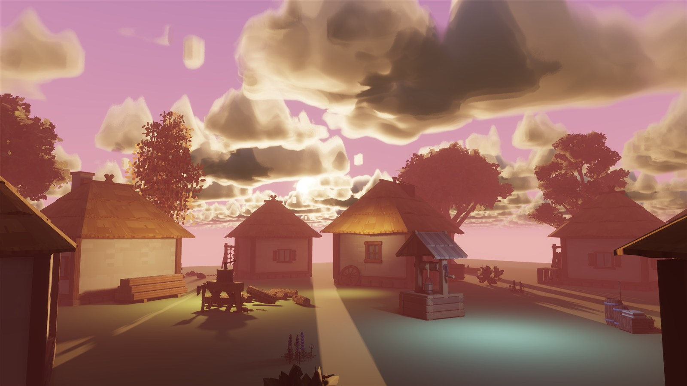
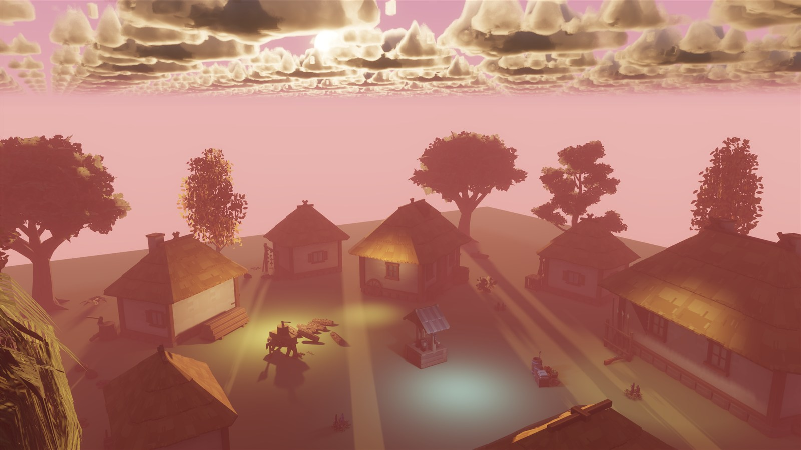
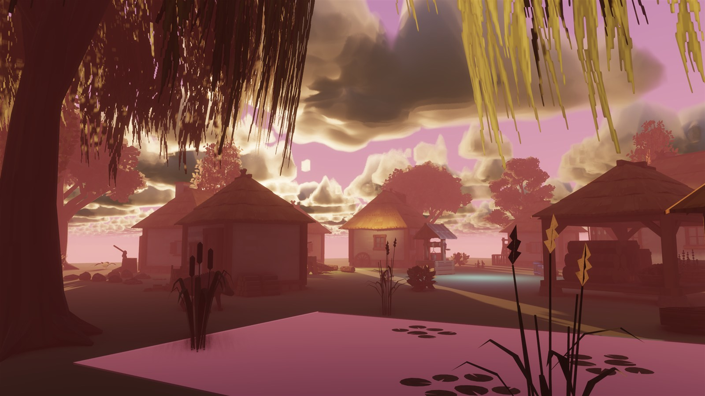

#  MelonEngine

A from-scratch 3D game engine written in Rust.



| | |
|---|---|
|  |  |

*The Sich village demo scene (`assets/scenes/sich_demo.ron`): DDGI, cascaded
sun shadows, SSAO, bloom and volumetric clouds, rendered with the snapshot
example.*

## Status

v0.1 — released.

## Crates

| Crate | Role |
|---|---|
| `melon_core` | Math (glam) re-exports, ECS (bevy_ecs) world/schedule bootstrap, Time resource |
| `melon_render` | wgpu device/swapchain, pipelines, meshes, glTF loading, WGSL shaders. Frame: sun shadow pass, 3D pass into an HDR target, then a tonemap pass onto the display, then an overlay pass (solid editor shapes such as the gizmo) |
| `melon_physics` | rapier3d wrapper + transform sync systems |
| `melon_editor` | egui-wgpu debug overlay (FPS, inspector, gizmos) |
| `melon_host` | Binary crate: winit event loop, wires all systems, loads the game plugin |
| `melon_game` | Game plugin (`GamePlugin`): game logic, live-reloaded in dev builds |

## Run

Dev build with hot reload:

```sh
cargo run -p melon_host
```

Hot reload: while it runs, edit `crates/melon_game` and rebuild only the game
crate. The editor reloads the game plugin and the Console shows "Game plugin
reloaded"; the scene stays as it is.

```sh
just game      # cargo build -p melon_host --lib
```

Changing the fields of any game component **or resource** type needs a
restart. Only a size/align change of a resource registered in `build` is
detected (the plugin stops with an error); any other field change is not, so
always restart. `build` must be idempotent: only `add_systems`,
`init_resource`, `insert_resource`. Spawning entities, observers or component
hooks from `build` repeats on every reload (a second hook registration panics).

`cargo test` / `just test` while a dev-run is open rewrites
`target/debug/melon_game.dll` with other features; the running host refuses
that reload (fingerprint error). Run `just game` again.

Or via the justfile:

```sh
just run       # gate (fmt + clippy + check) then run
just fast-run  # skip gate, run immediately
```

## Ship build

Release build with hot reload disabled (statically links melon_game):

```sh
just ship       # cargo build -p melon_host --release --no-default-features
just ship-run   # cargo run -p melon_host --release --no-default-features
```

## Controls

Viewport (Unity-style, pointer over the viewport):

- **Right drag** — look around
- **Right held + W/A/S/D** — fly; **Q / E** down / up; **Shift** ×3 speed
- **Right held + scroll** — change fly speed
- **Alt + left drag** — orbit around the pivot
- **Middle drag** — pan
- **Scroll** — zoom toward the pivot
- **F** — frame the selected entity
- **Left click** — select (click empty space to deselect); drag a gizmo handle to move/rotate/scale. Move: arrows (one axis), the small squares (two axes), the grey centre ball (free). Scale: cube tips (one axis), the triangles (two axes), the centre cube (uniform). Hold **Shift** while dragging to snap

Simulation:

- **F5** — Play / resume, **F6** — Pause, **Shift+F5** — Stop (restores the scene)
- While playing, the game owns keyboard and mouse (cursor hidden). **Esc**
  hands them back to the editor (the game keeps running); **left click** on
  the Scene viewport gives them to the game again
- **Step** (toolbar, while paused) — advance one fixed step

Editor:

- **W / E / R** — Move / Rotate / Scale tool
- **Delete** — delete the selected entity
- **Edit ▸ Project Settings ▸ Quality** — render quality presets (Low / Medium / High / Max) and
  each setting (GI, AO, shadow map, MSAA, bloom, frame pacing), with the measured GPU ms per pass;
  Apply to use, Save as / Load for named profiles
- **Ctrl+S** — save the scene (File ▸ Save As… the first time; it starts in
  `assets/scenes`)
- **Content Browser:** folder tree (right-click a folder to add it to
  Favorites), clickable path, Back / Forward (also mouse buttons 4 / 5),
  search (this folder and below), type filter chips, and a size slider whose
  far left switches tiles to a list. Model tiles show a rendered thumbnail
  (one per frame, refreshed when the file changes). Click selects; double-click (or Enter)
  opens a folder, asks Save / Don't Save / Cancel and loads a scene (`.ron`
  in `assets/`), or opens any other file in its default app. Right-click:
  New Folder, Rename (**F2**), Duplicate (**Ctrl+D**), Delete (**Del**, to the
  Recycle Bin; the dialog lists scenes that use it), Show in Explorer. Drag
  an item onto a folder to move it; drag files from Explorer onto the window
  to copy them into the current folder. Each `.meta` moves with its file. Favorites, size, folder and tree width are saved to
  `.melon/content_browser.ron`.
- **Ctrl+Space** (or the status bar's **Content Drawer** button) — the
  Content Browser in a drawer that slides up over the panels, when its tab
  is not in front (otherwise it brings the tab to the front). It hides on
  Esc, Ctrl+Space, a click outside it, or dragging an item out of it (the
  item drops on the Scene or Hierarchy below). **Dock in Layout** moves it
  back to its tab.
- **Models:** drag a `.glb` / `.gltf` from the Content Browser into the Scene
  (lands on the ground under the cursor) or the Hierarchy (at the origin, or
  under the row you drop it on). It unpacks into an entity per glTF node. Or
  pick a whole file in the Inspector's **Mesh** field, or drop one from the
  Content Browser onto it; **Show** jumps the browser to the model's file.
  Edit and re-export a model and the editor reloads it within about a second.
- Files added, moved or deleted under `assets/` outside the editor show up
  in the Content Browser within about half a second (move a file together
  with its `.meta` to keep references). Selecting a file in the browser shows
  its details (path, size, GUID, meshes, bounds) in the Inspector.
- **Inspector:** a card for every component on the selected entity (Transform
  first, then by name), edited in place. **Add Component** lists the
  components it can add (with a search field); **×** in a card's header
  removes that component (Transform and the name stay).
- **Hierarchy:** drag an entity onto another to make it a child (it keeps its
  place in the world), or onto the empty space below to make it a root.
  Deleting an entity deletes its children.
- **Edit ▸ Project Settings…** — Input Mapping: game actions (Button or
  Axis) and their keys / mouse buttons. **+ binding** (or **+ pair** for an
  axis: positive, then negative) waits for the next key; **Esc** cancels.
  Changes apply live and save to `config/input.ron`; a broken file falls
  back to the defaults and is kept as `config/input.ron.broken` on the first save.
- **Edit ▸ Project Settings ▸ Quality** — preset, per-setting render quality and named profiles; edits wait for **Apply** (saved to `config/quality.ron`).
- Panels (Hierarchy, Scene, Inspector, Content Browser, Console) dock and tab
  by dragging their tabs; the arrangement is saved to `.melon/editor_layout.ron`.
  **Window** reopens closed panels; **Window ▸ Reset Layout** restores the default.
- **Console** — one row per entry (time, level, target, message); **Wrap**
  shows full text, **Collapse** merges identical consecutive lines into one
  row with a ×N count, the search box filters message and target. Click a row
  to select it and see its details (full text, file:line), Shift+click a range,
  Ctrl+A all shown rows; **Ctrl+C** / **Copy** copy the selection, **Copy all**
  every shown row. It follows new lines at the bottom; scrolled up, a
  "Jump to latest" button counts new lines. **Home** / **End** scroll.
  Every captured line is also written to `.melon/logs/editor.log`
  (truncated at each start).

The editor opens in edit mode. Pass `--play` to start playing right away:

```sh
cargo run -p melon_host -- --play
```

## Assets

glTF models go in `assets/models/`, WGSL shaders in `assets/shaders/`.
The engine loads `assets/models/cube.glb` at startup as the central spinning
entity. See `assets/README.md` for details.

## Stack

- **ECS**: bevy_ecs 0.19
- **Render**: wgpu 29 (Vulkan/Metal/D3D12)
- **Window**: winit 0.30
- **Physics**: rapier3d 0.34
- **Editor UI**: egui 0.35 + egui-wgpu + egui-winit
- **Game reload**: libloading 0.8
- **Assets**: gltf 1.4, image 0.25
- **Math**: glam 0.33

## License

Dual-licensed under MIT or Apache-2.0, at your option. See `LICENSE-MIT`
and `LICENSE-APACHE`.